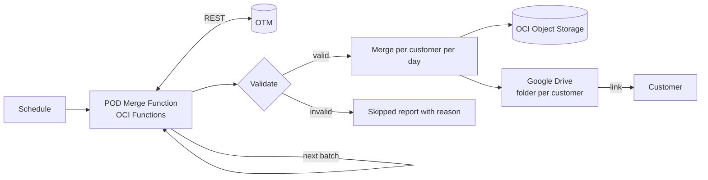

# Bulk OTM Documents Merger on OCI

> **Sanitized ACE project package.** Client names, OTM instance URLs and users, customer codes, OCIDs, Object Storage namespace and bucket, Google Drive folder and service account, and every credential have been removed or replaced with placeholders. All sample documents are synthetic.

## Overview

Proof-of-delivery (POD) documents are uploaded to **Oracle Transportation Management (OTM)** for every shipment, as scanned PDFs, phone photos, or multi-page TIFFs. Before they can be sent to a customer, someone has to open each shipment, download every POD, check it is readable, combine them, and email the result. With hundreds of deliveries a day, that is hours of manual work, and customers receive documents late and inconsistently.

This project replaces that work with a **serverless OCI Function**. On a schedule, it collects new POD documents from OTM, validates them, and merges them into **one PDF per customer per day**. It stores everything in **OCI Object Storage** and publishes the merged file to a **Google Drive** Shared Drive with a folder per customer. Operations teams share a Drive link with the customer instead of downloading, checking, and attaching files every time.

## Architecture

The full diagram is in [architecture.mmd](architecture.mmd).



## What it does

1. **Incremental pickup.** It queries OTM for POD documents updated since the stored watermark, oldest first, so every run continues exactly where the last one stopped.
2. **Customer resolution.** It reads the customer from the shipment or order release: a configurable attribute or reference number, with an involved-party fallback such as BILL-TO.
3. **Validation.** It handles each document according to what it finds:
   - An owner type that's out of scope is counted but not merged.
   - A 403 or 404 response from OTM is recorded with a plain-language reason.
   - A password-protected, corrupt, or non-image file is kept in `source/` but left out of the merge.
   - A temporary error is retried on later runs, then skipped with a reason.
4. **Conversion and merge.** It passes PDFs through unchanged and converts images, including every frame of a multi-page TIFF, to PDF pages. Pages are appended to the customer's file for the day. If a POD is re-uploaded in OTM, its old pages are replaced rather than duplicated.
5. **Delivery.** It uploads the merged PDF to Google Drive in a folder per customer. Later runs that day replace the file's content in place, so **the share link never changes**. A per-day `links/` index lists every customer's Drive link for email or APEX follow-up.
6. **Operations.** It includes:
   - an Object Storage lock so runs never overlap, with stale-lock recovery
   - conditional writes on the watermark
   - detached invokes with time and document budgets
   - automatic self-invocation to clear a backlog in further batches
   - a retry queue for Drive uploads
   - Markdown and JSON run reports

## Evidence (synthetic data, local run)

| File | Shows |
| --- | --- |
| [01-unit-tests-passing.png](evidence/01-unit-tests-passing.png) | 12 offline tests: conversion, merge resilience, grouping, validation, Drive links, append/replace, no reprocessing, batching, locking |
| [02-run1-merge-and-validation.png](evidence/02-run1-merge-and-validation.png) | 8 PODs → 3 merged customer files with Drive links; out-of-scope, 403, and unsupported files reported with reasons |
| [03-run2-append-and-replace.png](evidence/03-run2-append-and-replace.png) | Later the same day: a new POD is appended and a re-scanned POD replaces its old pages, with the same Drive links |
| [04-object-storage-layout.png](evidence/04-object-storage-layout.png) | Object Storage layout and the per-day Drive link index |
| [demo-output/](evidence/demo-output/) | The merged synthetic PDFs and the run reports themselves |

The evidence comes from the production pipeline code running against in-memory stand-ins for OTM, Object Storage, and Google Drive ([local_runner/fakes.py](local_runner/fakes.py)).

## Repository layout

```text
Bulk OTM Documents Merger/
├── README.md
├── architecture.mmd
├── .env.example                 configuration template (placeholders only)
├── .gitignore
├── docs/
│   ├── ACE_SUBMISSION.md
│   ├── EVIDENCE_CHECKLIST.md
│   └── RUNBOOK.md               operations: deploy, invoke, check, reprocess, rotate keys
├── sanitized-source/
│   ├── README.md
│   └── otm-pod-merge/
│       ├── func.py              OCI Functions entry point, detached detection, self-invoke
│       ├── pipeline.py          watermark, validation, grouping, append/replace, Drive sync
│       ├── otm_client.py        OTM REST: document search, customer lookup, download
│       ├── pdfs.py              image→PDF conversion and resilient merge (pypdf + Pillow)
│       ├── gdrive.py            Google Drive REST upload (service account or OAuth)
│       ├── store.py             Object Storage with conditional writes
│       ├── reports.py           run and skipped-document reports
│       ├── config.py            settings from function configuration
│       ├── run_local.py         run against real services from a workstation
│       ├── Dockerfile, func.yaml, requirements.txt
├── deploy/
│   ├── deploy.ps1               build, push to OCIR, create/update the function
│   └── gdrive_authorize.py      one-time OAuth consent (alternative to a service account)
├── local_runner/
│   ├── fakes.py                 in-memory OTM / Object Storage / Drive + synthetic PODs
│   └── run_demo.py              two-run end-to-end demo
├── tests/
│   └── test_pod_merge.py
├── tools/
│   └── render_evidence.py
└── evidence/
```

## Run locally (no credentials needed)

```bash
pip install pypdf pillow requests google-auth oci fdk tzdata
python -m unittest discover -s tests -v
python local_runner/run_demo.py
```

## Deploy to OCI

1. Copy `.env.example` to `.env` and fill in the OTM URL, user, and password, plus the bucket. `.env` is git-ignored.
2. Upload the Google credentials (a service-account key with Content manager rights on the Shared Drive folder) to `<OS_PREFIX>/_config/gdrive_credentials.json` in a **private** bucket. They are never baked into the image or the function configuration.
3. Deploy:
   ```powershell
   powershell -ExecutionPolicy Bypass -File deploy\deploy.ps1 -AppId <application-ocid> -CompartmentId <compartment-ocid> -Region <region-key>
   ```
4. Schedule a **detached** invoke, for example every 30 minutes. See [docs/RUNBOOK.md](docs/RUNBOOK.md) for operations.

Grant the function's dynamic group `manage objects` on the bucket, plus `use fn-invocation` for its own function so it can continue a backlog. Move `OTM_PASSWORD` to OCI Vault for production.

## OCI services used

| Service | Role |
| --- | --- |
| OCI Functions | Serverless pipeline with detached invokes and self-continuation for backlogs |
| OCI Object Storage | Originals, merged PDFs, manifests, link index, watermark state, lock, reports, Drive credentials |
| OCI Registry (OCIR) | Private container image for the function |
| OCI IAM | Resource principal, dynamic group, least-privilege policies |
| OCI Logging | Invocation logs and run summaries |
| Oracle Transportation Management | Source of POD documents and shipment/customer data (REST API) |

## Author contribution

I designed and built this serverless document pipeline: the incremental OTM integration with watermark and replay safety, POD validation and image-to-PDF conversion, per-customer daily merging with in-place append and replace, the Object Storage state, locking, and reporting model, Google Drive delivery with stable share links, the self-continuing batch design for large backlogs, and the deployment tooling, tests, and runbook.
